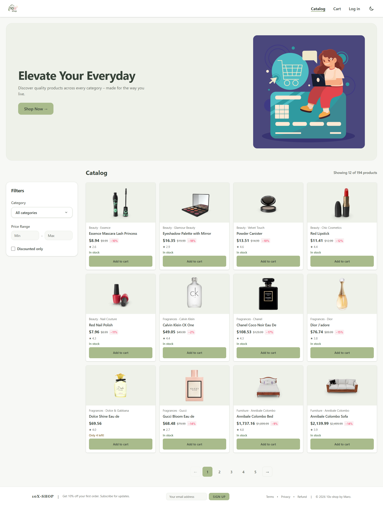
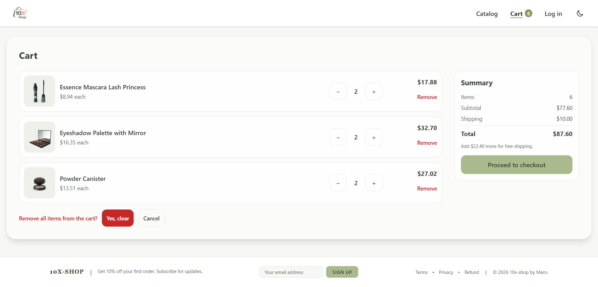
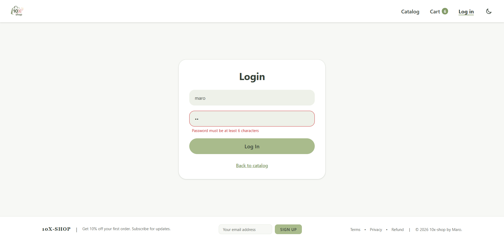
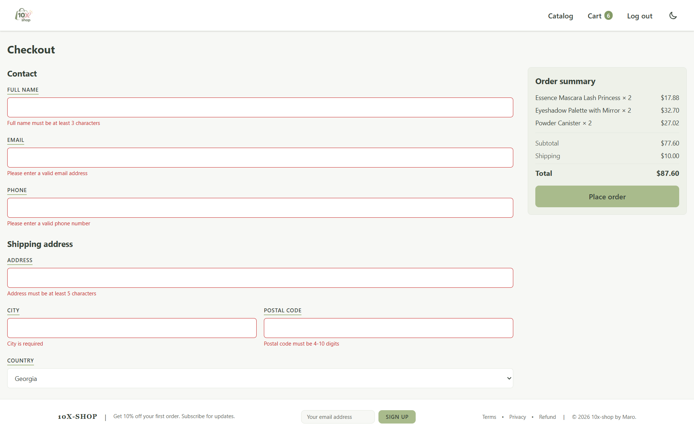
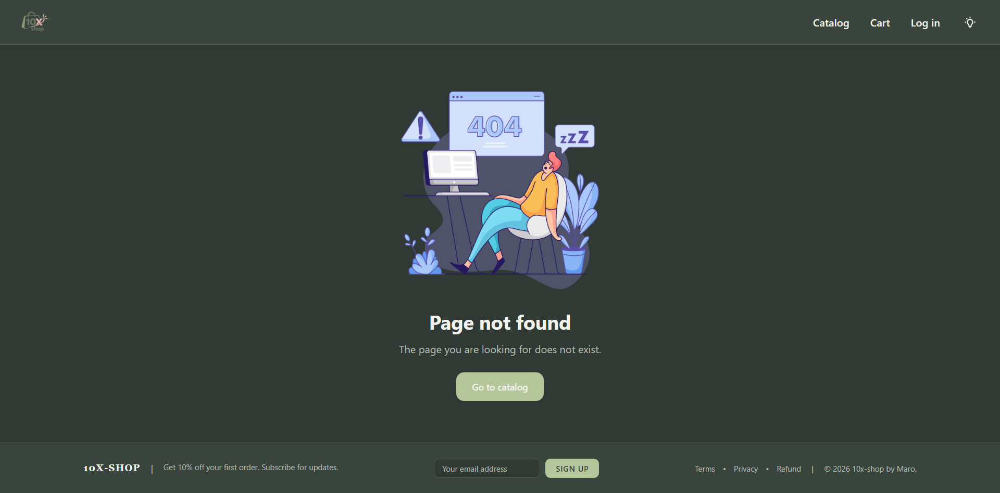
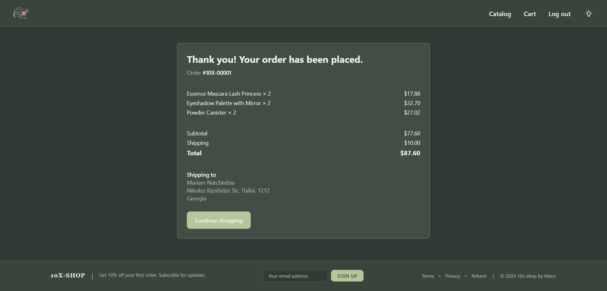

# 10X Shop

A responsive online-store SPA built as the individual diploma project of the 10X Front-end course. Products come from the public [DummyJSON](https://dummyjson.com) API; login and checkout are local simulations (no real authentication or payments).

**Live demo:** https://10x-shop-maro.vercel.app

## Features

**CORE**
- Catalog (`/`) – products loaded from DummyJSON with loading / error / empty states
- Product page (`/products/:id`) – gallery, discounted price, stock status, quantity stepper, Add to cart; invalid or unknown ids show the 404 page
- Cart (`/cart`) – add, change quantity, remove, clear, subtotal / shipping / total; saved in `localStorage` (`shop_cart`)
- Login (`/login`) – controlled form with validation; state kept in `AuthContext`
- Checkout (`/checkout`) – protected route (guests are sent to `/login` and returned afterwards), controlled form with validation, local order confirmation, cart is cleared
- 404 page, global `ErrorBoundary`, shared Layout with Header and Footer

**FULL / extras implemented**
- Category filter (custom accessible `CategorySelect`) and pagination
- Order saved to `localStorage` (`shop_orders`)
- Dark / light theme (`shop_theme`)
- Price-range and "discounted only" filters (applied to the currently loaded page)

## Tech stack
React 19, TypeScript (`strict`), Vite, React Router, Tailwind CSS v4, DummyJSON API, deployed on Vercel (`vercel.json` rewrites all routes to `index.html`).

## Architecture
```
src/
├── api/         products.api.ts
├── components/  layout/ (Header, Footer, Layout, ScrollToTop)
│                product/ (ProductCard, ProductGrid)
│                ui/ (CategorySelect, Toast)
│                ErrorBoundary.tsx
├── context/     AuthContext / AuthProvider / useAuth
│                CartContext / CartProvider / useCart
├── pages/       Catalog, Product, Cart, Checkout, Login, NotFound
├── routes/      AppRoutes, ProtectedRoute
├── types/       product, cart, order
└── utils/       format, orders, checkoutValidation
```
Data flow: user action → event handler → `useState` / Context setter → new immutable state → re-render. API calls run in `useEffect` with an `ignore` flag so an outdated response can never overwrite a newer one. `AuthProvider` and `CartProvider` wrap the app in `main.tsx`; the cart is persisted to `localStorage` on every change.

## How to run
```bash
git clone https://github.com/mariami1natchkebia/10x-Shop-Mariamo-Natchkebia.git
cd 10x-Shop-Mariamo-Natchkebia
npm install
npm run dev
```

## Scripts
| Script | What it does |
| --- | --- |
| `npm run dev` | start the Vite dev server |
| `npm run build` | type-check and create a production build |
| `npm run preview` | serve the production build locally |
| `npm run typecheck` | `tsc -b` (strict mode, 0 errors required) |
| `npm run lint` | ESLint (`typescript-eslint`, `react-hooks`) |

## Test account
Login is a local simulation: any non-empty username and a password of at least 6 characters work.

## Credits
Product data: [DummyJSON](https://dummyjson.com). AI assistance (Claude) was used for code review and documentation drafting; see `REPORT.md` for details.

## Screenshots

Catalog Page



Cart Page



Login Page



Checkout Page




Not Found Page (404)



Product Details Page


Proceed To Checkout


