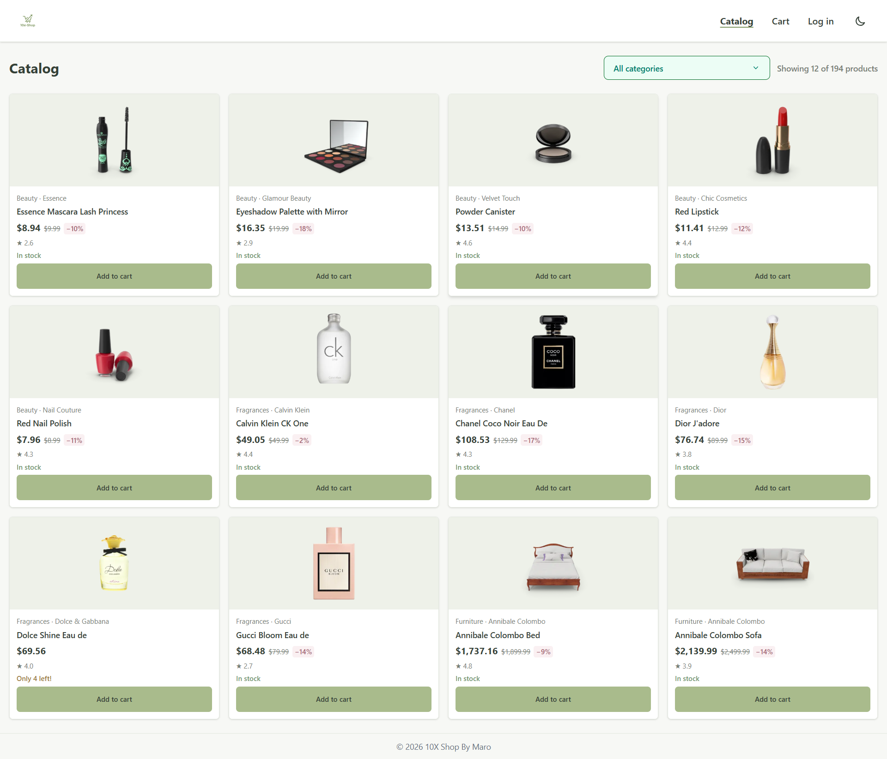
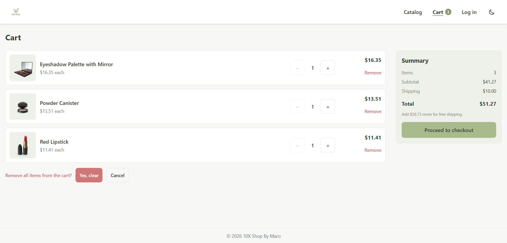
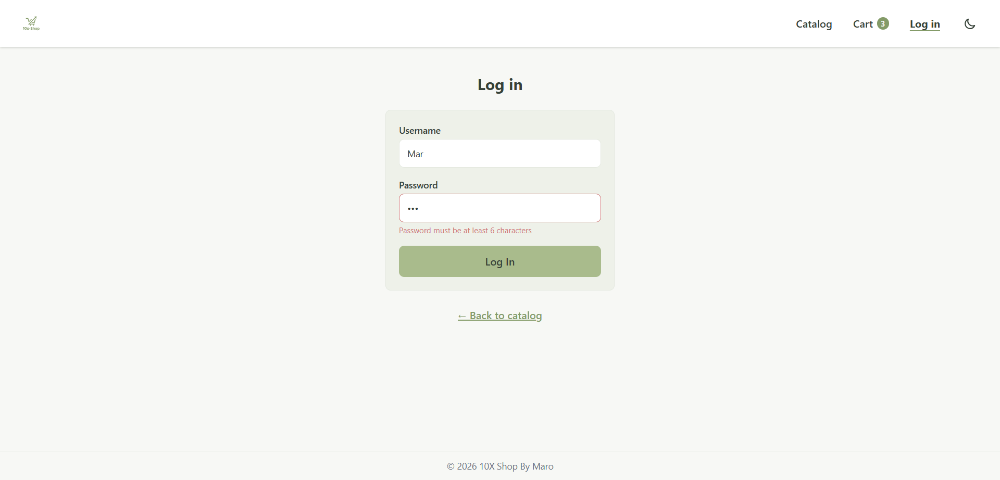
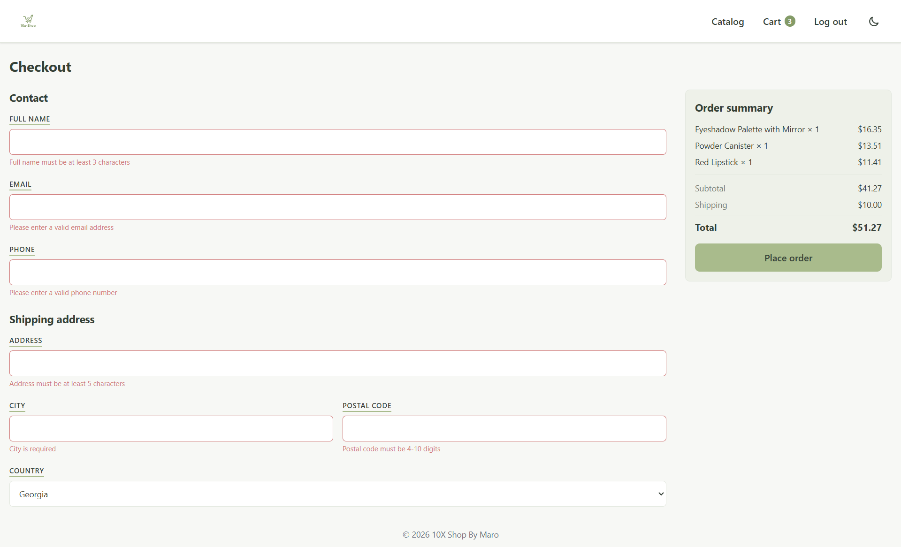
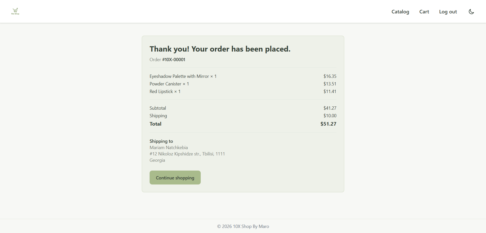
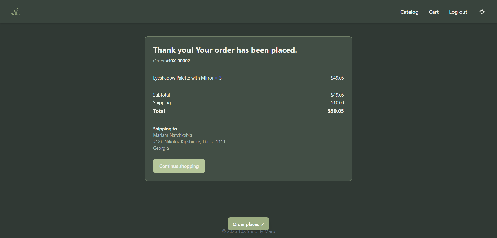

# 10X Shop — E-Commerce Single Page Application

A modern, highly performant, and fully responsive E-Commerce Single Page Application (SPA) built with React 19, TypeScript (strict mode), Tailwind CSS v4, and integrated with the DummyJSON API. Developed as a diploma project for the 10X Front-end course.

**Live Demo**: [https://10x-shop-maro.vercel.app](https://10x-shop-maro.vercel.app)

---

## 🚀 Key Features

### 🛒 CORE Functionality
- **Catalog Page (`/`)**: Displays products fetched asynchronously from DummyJSON API with loading, error, and category filtering states.
- **Product Details Page (`/products/:id`)**: Detailed product view featuring image galleries, stock status calculations, descriptions, and dynamic route params handling.
- **Shopping Cart (`/cart`)**: Complete state management with immutable updates via React Context. Supports quantity updates, item removal, and automatic subtotal/total calculations.
- **Authentication Simulation (`/login`)**: Simple local authentication state using `AuthContext`. Guest users attempting to access protected routes are automatically redirected.
- **Controlled Checkout (`/checkout`)**: Multi-field form with strict client-side validation, error handling, order summary, and order confirmation simulation.
- **Protected Routing (`ProtectedRoute`)**: Restricts access to the checkout flow, remembering the intended navigation path.
- **Error Handling & Resiliency**: Integrated global `ErrorBoundary` component ensuring graceful runtime error fallbacks.

---

## 🛠️ Tech Stack & Tools

- **Framework**: React 19 + Vite
- **Language**: TypeScript (`strict: true`)
- **Styling**: Tailwind CSS v4 (Utility-first styling, CSS custom variables)
- **Routing**: React Router v7 (`react-router-dom`)
- **State Management**: React Context API (Auth & Cart management)
- **API**: DummyJSON Public REST API (`fetch`)
- **Deployment**: Vercel

---

## 📁 Project Architecture
src/
├── api/                  # API request functions (products.api.ts)
├── components/           # Reusable UI components
│   ├── layout/           # Header, Footer, Layout, ScrollToTop
│   ├── product/          # ProductCard, ProductGrid
│   └── ui/               # CategorySelect, Toast, ErrorBoundary
├── context/              # Global state management
│   ├── AuthContext.tsx   # Auth context definition & hook
│   ├── AuthProvider.tsx  # Auth provider implementation
│   ├── CartContext.tsx   # Cart context definition & hook
│   └── CartProvider.tsx  # Cart provider implementation
├── pages/                # Page route components
│   ├── CatalogPage.tsx   # Product catalog view
│   ├── ProductPage.tsx   # Detailed product view
│   ├── CartPage.tsx      # Shopping cart view
│   ├── CheckoutPage.tsx # Form validation & order confirmation
│   ├── LoginPage.tsx    # User login form
│   └── NotFoundPage.tsx # 404 Error page
├── routes/               # Routing setup & guards
├── routes/               # Routing setup & guards
│   ├── AppRoutes.tsx     # Route declarations
│   └── ProtectedRoute.tsx# Route guard for auth
├── types/                # TypeScript interfaces & types
│   ├── cart.ts           # Cart types
│   ├── order.ts          # Order & Shipping types
│   └── product.ts        # Product & Category types
└── utils/                # Helper utilities
├── checkoutValidation.ts # Form validation logic
├── format.ts         # Currency & discount formatters
└── orders.ts         # Shipping calculation & storage helpers
---

## 🧪 Setup & Execution

1. **Clone the repository:**
   ```bash
   git clone [https://github.com/mariami1nachkebia-5502/10x-shop.git](https://github.com/mariami1nachkebia-5502/10x-shop.git)
   cd 10x-shop

   ## Screenshots

### catalog-page


### cart-page


### login-page


### checkout-page


### placed-order


### dark-mode

